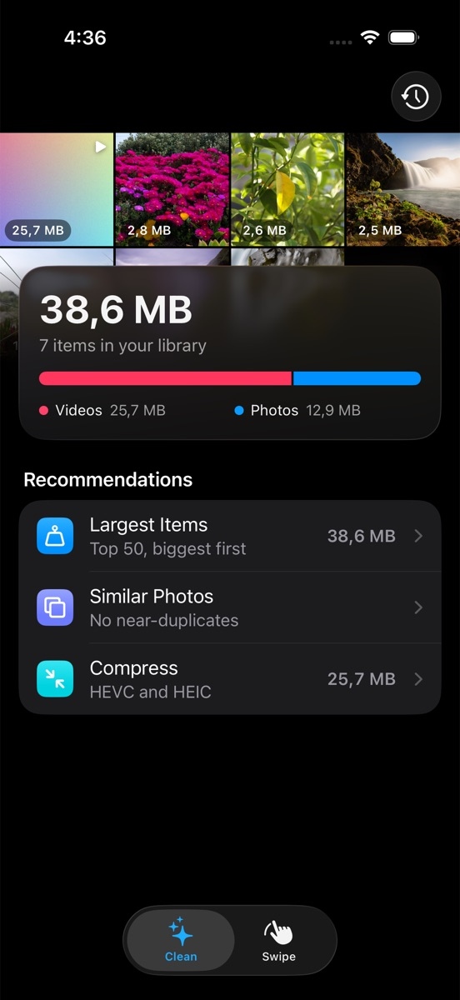

# EvictLib

Free up iCloud Photos space on your iPhone. No subscription, no quota, no account, no server: everything runs on the device through PhotoKit.

**Website:** https://vassilidev.github.io/EvictLib/

<p>
  
  
  
</p>

## Features

- **Largest Items**: your library sorted by real file size, biggest first.
- **Similar Photos and Bursts**: near-duplicates grouped, best shot kept.
- **Compress**: videos to HEVC, photos to HEIC, ProRAW to HEIC, slow-motion to 30 fps. Date, location, favorite, albums and EXIF are kept.
- **Live Photos to stills**.
- **Swipe**: left deletes, right keeps, up favorites, with Undo.
- **History** of what was freed.

Deleted items go to *Recently Deleted* for 30 days, and iOS asks for confirmation on every delete. Favorites and album items are protected by default.

Requires iOS 17 or later and full Photos access.

## Install on any iPhone

EvictLib is not on the App Store. Pick one of the two ways below.

> With a free Apple ID, Apple limits sideloaded apps to **7 days** (then re-sign or re-run to keep using it) and **3 apps** at a time. A paid Apple Developer account lifts this to one year.

### Option A: download the app (Windows or Mac, no Xcode)

1. Download [`EvictLib.ipa`](https://github.com/vassilidev/EvictLib/releases/latest/download/EvictLib.ipa) from the [latest release](https://github.com/vassilidev/EvictLib/releases/latest).
2. Install [Sideloadly](https://sideloadly.io) on your computer (or use [AltStore](https://altstore.io) / [SideStore](https://sidestore.io)).
3. Plug in your iPhone, drag `EvictLib.ipa` into Sideloadly, enter your Apple ID, click **Start**.
4. On the iPhone, follow the steps in [First launch](#first-launch).

### Option B: build from source (Mac with Xcode)

1. Install [Xcode](https://apps.apple.com/app/xcode/id497799835) 16 or later. Your Xcode must support your iPhone's iOS version.
2. Clone and open the project:
   ```sh
   git clone https://github.com/vassilidev/EvictLib.git
   open EvictLib/EvictLib.xcodeproj
   ```
3. In Xcode, add your Apple ID under **Settings › Accounts**.
4. Select the **EvictLib** target › **Signing & Capabilities**:
   - **Team**: your Apple ID (Personal Team).
   - **Bundle Identifier**: change it to something unique, e.g. `com.yourname.evictlib`.
5. Plug in your iPhone, select it as the run destination, press **⌘R**.
6. On the iPhone, follow the steps in [First launch](#first-launch).

### First launch

1. **Developer Mode** (iOS 16+): Settings › Privacy & Security › Developer Mode › On, then restart.
2. **Trust the developer**: Settings › General › VPN & Device Management › your Apple ID › Trust.
3. Open EvictLib and allow **Full Access** to Photos.

To get the space back in iCloud, empty *Recently Deleted* in Photos once you are done.

## Development

```sh
xcodebuild test -scheme EvictLib -destination 'platform=iOS Simulator,name=iPhone 17 Pro'
```

Build the unsigned IPA attached to releases:

```sh
xcodebuild archive -scheme EvictLib -configuration Release -destination 'generic/platform=iOS' \
  -archivePath build/EvictLib.xcarchive CODE_SIGNING_ALLOWED=NO
mkdir -p build/Payload && cp -R build/EvictLib.xcarchive/Products/Applications/EvictLib.app build/Payload/
(cd build && zip -qry EvictLib.ipa Payload)
```

## License

[MIT](LICENSE)
