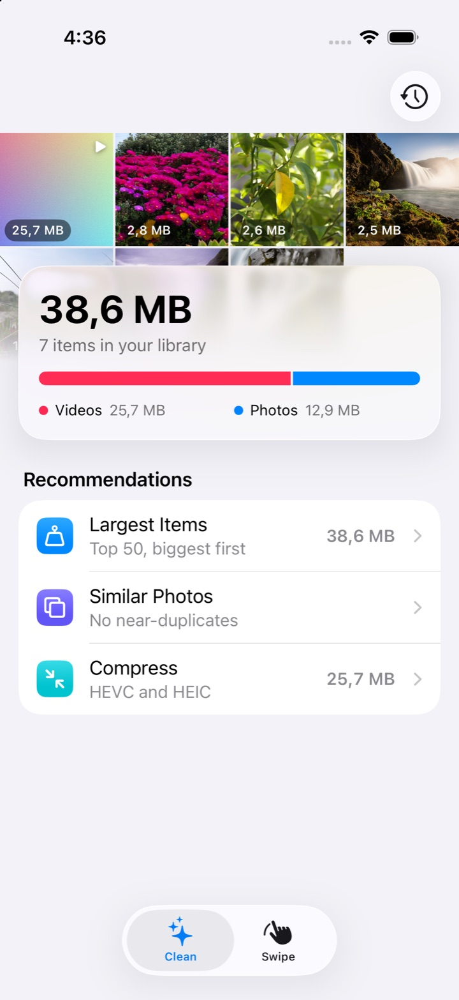
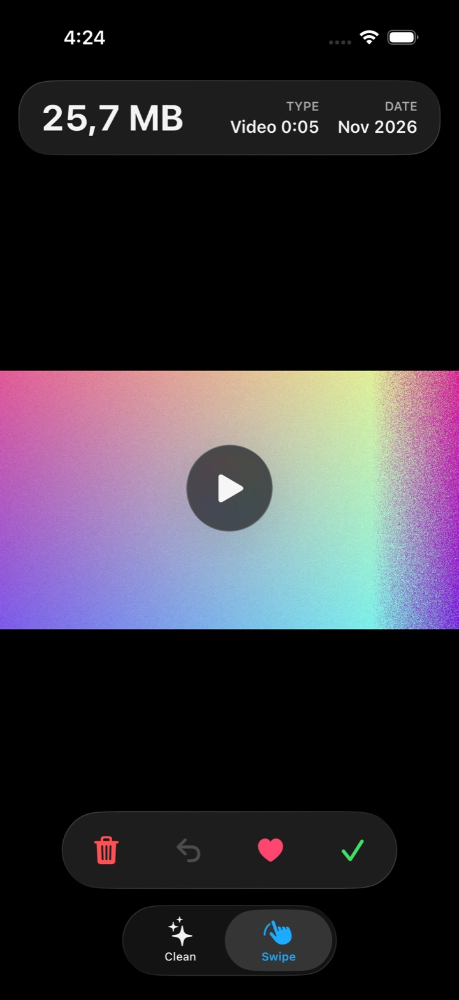

# EvictLib

Free up iCloud Photos space on your iPhone. Biggest items first, no subscription, no quota. Everything stays on your phone.

**Website:** https://vassilidev.github.io/EvictLib/

<p>
  
  
  
</p>

## What it does

- **Largest Items**: your photos and videos sorted by size, biggest first.
- **Similar Photos and Bursts**: duplicates grouped, the best shot kept.
- **Compress**: makes heavy videos and photos smaller, keeping date, location and albums.
- **Live Photos to stills**: keeps the photo, drops the video part.
- **Swipe**: left to delete, right to keep, up to favorite.

Nothing is deleted without the iPhone asking you first, and deleted items stay 30 days in *Recently Deleted*.

## Install it on your iPhone

EvictLib is not on the App Store. You install it once from a computer.

**Why a computer?** The app comes as a file called `EvictLib.ipa`. An iPhone can't open that file by itself. A free app called **Sideloadly** signs it with your Apple ID and puts it on your iPhone through the cable.

**You need:** an iPhone with iOS 17 or later, a Mac or Windows PC, a USB cable, and an Apple ID (the one you already use is fine).

### On your computer

1. **Download the app:** [EvictLib.ipa](https://github.com/vassilidev/EvictLib/releases/latest/download/EvictLib.ipa).
2. **Install Sideloadly** from [sideloadly.io](https://sideloadly.io). On Windows, also install iTunes from apple.com, as Sideloadly's site explains.
3. **Plug in your iPhone**, unlock it, and tap **Trust** if it asks.
4. **Open Sideloadly**, drag `EvictLib.ipa` into it, type your Apple ID email, and click **Start**. Sign in when it asks.

### On your iPhone

5. **Turn on Developer Mode:** Settings › Privacy & Security › Developer Mode › On. The iPhone restarts; tap **Turn On**.
6. **Trust your Apple ID:** Settings › General › VPN & Device Management › your Apple ID › **Trust**.
7. **Open EvictLib** and allow **Full Access** to Photos.

Done. To get the space back in iCloud, empty *Recently Deleted* in the Photos app.

### Every 7 days

With a free Apple ID, Apple makes the app stop opening after 7 days. Plug in your iPhone and click **Start** again in Sideloadly to renew it. Your photos are never affected.

## For developers

Build and run with Xcode 16 or later: open `EvictLib.xcodeproj`, set your team and a unique bundle identifier in **Signing & Capabilities**, pick your iPhone, press **⌘R**.

Run the tests:

```sh
xcodebuild test -scheme EvictLib -destination 'platform=iOS Simulator,name=iPhone 17 Pro'
```

Build the unsigned `EvictLib.ipa` published in releases:

```sh
xcodebuild archive -scheme EvictLib -configuration Release -destination 'generic/platform=iOS' \
  -archivePath build/EvictLib.xcarchive CODE_SIGNING_ALLOWED=NO
mkdir -p build/Payload && cp -R build/EvictLib.xcarchive/Products/Applications/EvictLib.app build/Payload/
(cd build && zip -qry EvictLib.ipa Payload)
```

## License

[MIT](LICENSE)
